<h1 align="center">Hi 👋, This is Chhavi</h1>

<h3 align="center">Aspiring Software Engineer</h3>

  

---

### 👩‍💻 About Me

- 🎓 Pursuing BCA in **Data Science & Artificial Intelligence**.
- 💡 Curious about how technology, data and intelligent systems shape the future.
- 🌱 Currently strengthening my foundations in **Python, Java, SQL and Data Science**.
- 📊 Interested in **Data, Softwares, Machine Learning and Artificial Intelligence**.
- 🚀 Learning to build, experiment and solve problems through code.
- 🎮 Gaming enthusiast and creative video editor.
- ✨ Welcomes different perspectives and enjoys finding new approaches

### 🛠️ Tech Stack

  

### 🚀 Featured Projects

**1. Customer Sales Analysis**
- Analyzing customer sales data
- Exploring patterns and business insights

**2. Sales Report for Industry**
- Working with sales data
- Presenting business performance insights

**3. NeuralScent – AffectAI**
- Developed an end-to-end deep learning project for text-based emotion classification across six emotion categories.
- Compared RNN, LSTM and GRU architectures to develop an Advanced Stacked Bidirectional GRU model.
- Deployed the final model using FastAPI with a web interface for real-time text analysis.
- **Technologies:** Python, Deep Learning, RNN, LSTM, GRU, FastAPI.

### 📊 GitHub Statistics

  
  

### 🔥 Contribution Streak

  

### 🌐 Connect With Me 

  
  
  
  

---

  <i>"Building at the Intersection of AI, Technology & Human Potential."</i>

